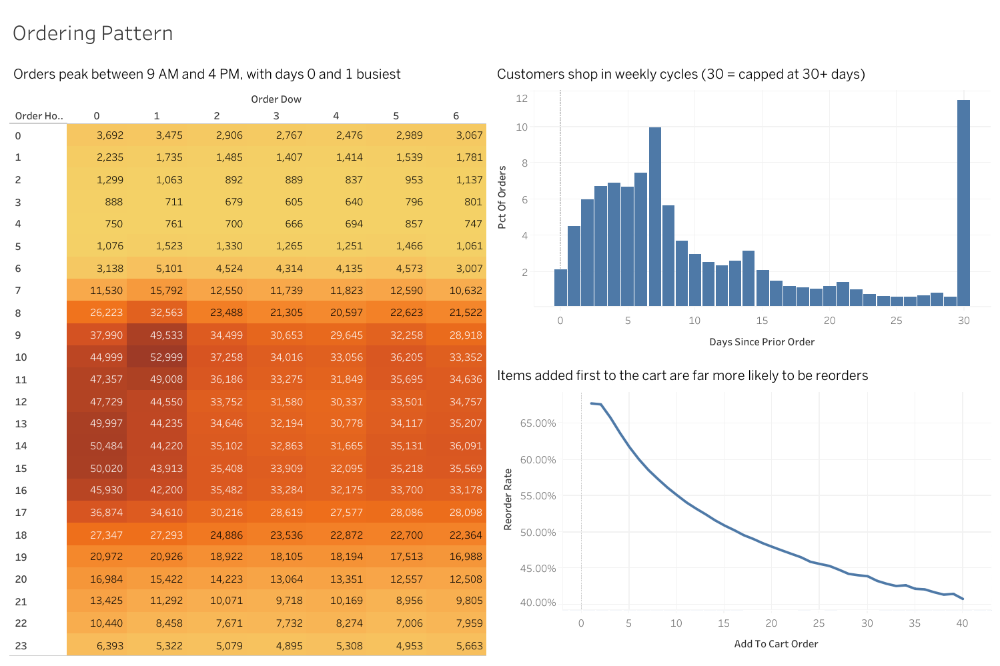
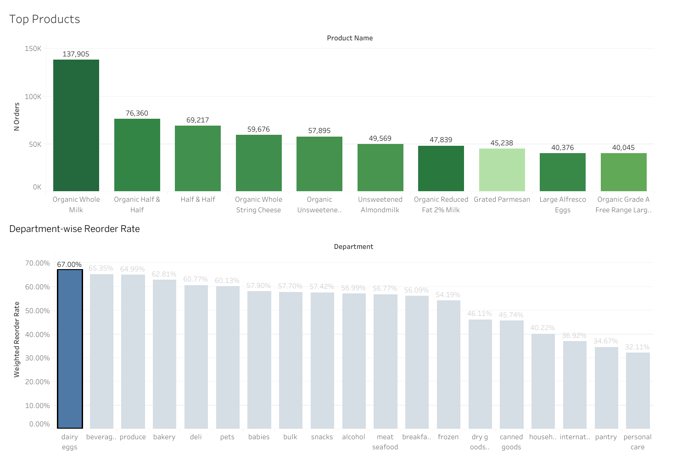
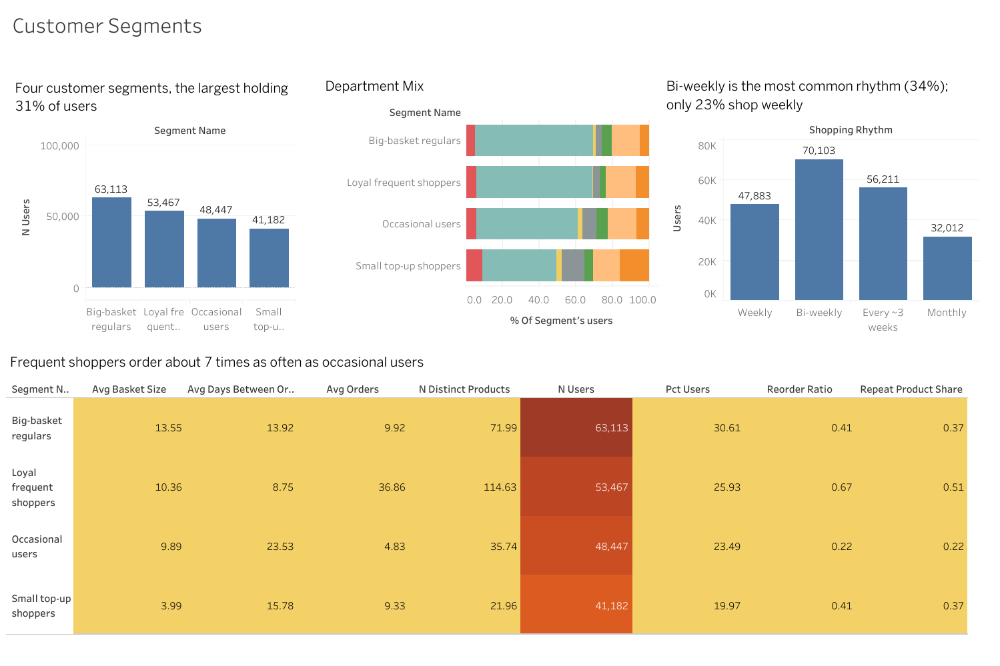

# Instacart Customer Behavior Analysis

**SQL → pandas → Tableau**

An end-to-end analytics project on the Instacart Online Grocery Shopping Dataset (3.4M orders, 32M order-product rows). It looks at **when** customers order, **how often** they return, **what** they reorder and **which customer segments** exist, and turns the findings into recommendations.

**Live dashboards:** [Tableau Public](https://public.tableau.com/app/profile/dharshini.s5373/viz/InstacartCustomerBehaviorAnalysis_17945554280810/CustomerSegments)

> **Business question:** *How can Instacart increase customer retention and basket size by understanding how customers order and reorder?*

---

## Dashboards

| Ordering Patterns | Products and Departments | Customer Segments |
|---|---|---|
|  |  |  |


---

## Dataset

[Instacart Market Basket Analysis (Kaggle)](https://www.kaggle.com/c/instacart-market-basket-analysis/data)

| Item | Count |
|---|---|
| Orders | 3,421,083 |
| Order-product rows (prior) | 32,434,489 |
| Users | 206,209 |
| Products / aisles / departments | 49,688 / 134 / 21 |

**Important limits:** there are no prices, no revenue and no real dates. The analysis is about behavior (frequency, timing, reordering, basket composition), not profit. `days_since_prior_order` is capped at 30, and the day-of-week codes (0 to 6) are not labelled in the dataset.

---

## Project pipeline

| Step | Notebook | What it does |
|---|---|---|
| 1 | `01_SQL_Extraction_and_Aggregation.ipynb` | Loads the CSVs into SQLite, indexes join keys, runs data-quality checks, builds staging tables and answers the descriptive questions with SQL (CTEs, `RANK`, `LAG`, cumulative `SUM() OVER`, `HAVING`) |
| 2 | `02_Pandas_Analysis_and_Segmentation.ipynb` | Memory-efficient loading, validation, cross-check against SQL, feature engineering, cart-position and aisle-pair analysis, K-means customer segmentation |
| 3 | Tableau Public | Three interactive dashboards built from the exported summary tables |

### Engineering highlights
* Loaded 32M rows into SQLite in chunks, with indexes on all join keys and materialized staging tables (`product_stats`, `order_sizes`).
* Cut memory use with dtype downcasting, Parquet caching and NumPy array lookups instead of repeated 32M-row merges.
* Validated the data with explicit checks (null patterns, duplicate keys, orphan keys) and guarded merges with `validate=`.
* **Cross-checked SQL against pandas:** both pipelines produce identical per-user order and item counts.
* Tableau receives small pre-aggregated tables, never the raw 32M rows.

---

## Key findings

**Ordering patterns**
* About half of all orders arrive within 7 days of the previous one, with a clear spike at day 7. The bar at day 30 is a capped value ("30 or more"), not a monthly habit.
* Orders peak between 9 AM and 4 PM. Days 0 and 1 are the busiest, and the single busiest cell is day 1 at 10 AM (52,999 orders).
* Orders drop sharply between about 1 AM and 5 AM.

**Reordering**
* Reorder rate varies widely by department: **dairy eggs 67.0%, beverages 65.4%, produce 65.0%** at the top, and **pantry 34.7%, personal care 32.1%** near the bottom. Staples and perishables are habits; pantry and personal care are more exploratory.
* At aisle level, milk reorders at 78.1%, while spices and seasonings sit at 15.2%.
* Banana is the standout product: 472,565 orders with an 84.4% reorder rate.
* Items added to the cart first are far more likely to be reorders: about 68% for the first item, falling to about 41% by the 40th.

**Basket size**
* 62% of orders contain 10 items or fewer, and only 0.1% contain 51 or more.
* Average basket size is flat as customers mature (about 10.1 items at the first order and 10.2 at order 20 or later). Baskets do not grow on their own.

**Customer segments**

| Shopping rhythm | Share of users | Avg orders | Reorder ratio |
|---|---|---|---|
| Weekly | 23.2% | 31.4 | 0.556 |
| Bi-weekly | 34.0% | 15.3 | 0.466 |
| Every ~3 weeks | 27.3% | 8.4 | 0.365 |
| Monthly | 15.5% | 5.1 | 0.292 |

K-means (k = 4) on frequency, basket size, reorder ratio and gap length gives:

| Segment | Users | Avg orders | Days between | Basket size | Reorder ratio |
|---|---|---|---|---|---|
| Loyal frequent shoppers | 53,467 | 36.9 | 8.8 | 10.4 | 0.67 |
| Big-basket regulars | 63,113 | 9.9 | 13.9 | 13.6 | 0.41 |
| Small top-up shoppers | 41,182 | 9.3 | 15.8 | 4.0 | 0.41 |
| Occasional users | 48,447 | 4.8 | 23.5 | 9.9 | 0.22 |

Produce is the top department in every segment, but top-up shoppers lean more toward beverages, dairy eggs and snacks.

**Basket analysis:** staple aisles co-occur up to about 1.9× more than chance (lift), with crackers and cereal the strongest pair seen. Associations are moderate, not dramatic.

---

## Recommendations

These are hypotheses suggested by the data. Confirming them would need an A/B test.

1. **Nudge bi-weekly and monthly shoppers toward a weekly habit.** Weekly shoppers reorder far more, so reminders around day 7 are a natural test.
2. **"Buy it again" shortcuts for dairy, produce and beverages**, the categories with the strongest reorder habits.
3. **Discovery promotions for low-reorder categories** (pantry, personal care, household), where customers are still exploring.
4. **Place recommendations after habitual items in the cart**, since habitual items are added first.
5. **Staff and schedule promotions around the 9 AM to 4 PM peak.**
6. **Re-engagement offers for occasional users**, the segment with the fewest orders and longest gaps.

---

## Limitations

* No prices, promotions, inventory or real dates, so findings are behavioral rather than revenue-based.
* The 30-day cap on `days_since_prior_order` hides long gaps, so monthly shoppers cannot be separated from lapsed users.
* The link between order frequency and reorder ratio is partly mechanical: more orders means more history to reorder from.
* Segments are descriptive, not predictive. The aisle-pair analysis uses a 100,000-order sample.
* Offline metrics do not prove real-world impact.

---

## How to run

1. Download the dataset from Kaggle and put the CSVs in `data/`.
2. Open the notebooks in Google Colab (or Jupyter) and adjust `PROJECT_PATH` in the setup cell.
3. Run them **in order**: `01` → `02`. Each saves tables to `outputs/` for the next step and for Tableau.
4. Load the `outputs/` CSVs into Tableau as separate data sources (do not join them).

**Requirements:** Python 3, pandas, NumPy, SciPy, scikit-learn, Matplotlib, Seaborn, PyArrow. SQLite is included with Python.

```
├── notebooks/
│   ├── 01_SQL_Extraction_and_Aggregation.ipynb
│   └── 02_Pandas_Analysis_and_Segmentation.ipynb
├── outputs/        # summary CSVs used by Tableau
├── images/         # dashboard screenshots
└── README.md
```

## Tech stack
SQL (SQLite) · Python · pandas · NumPy · scikit-learn (K-means) · Matplotlib · Seaborn · Tableau Public · Google Colab
